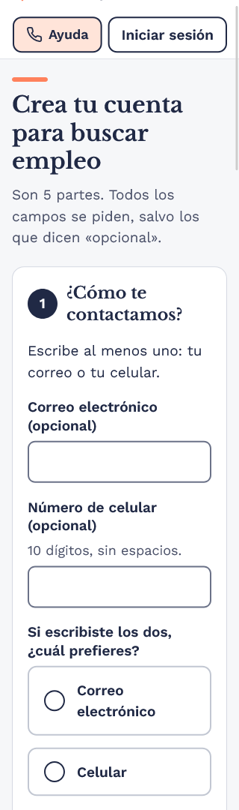
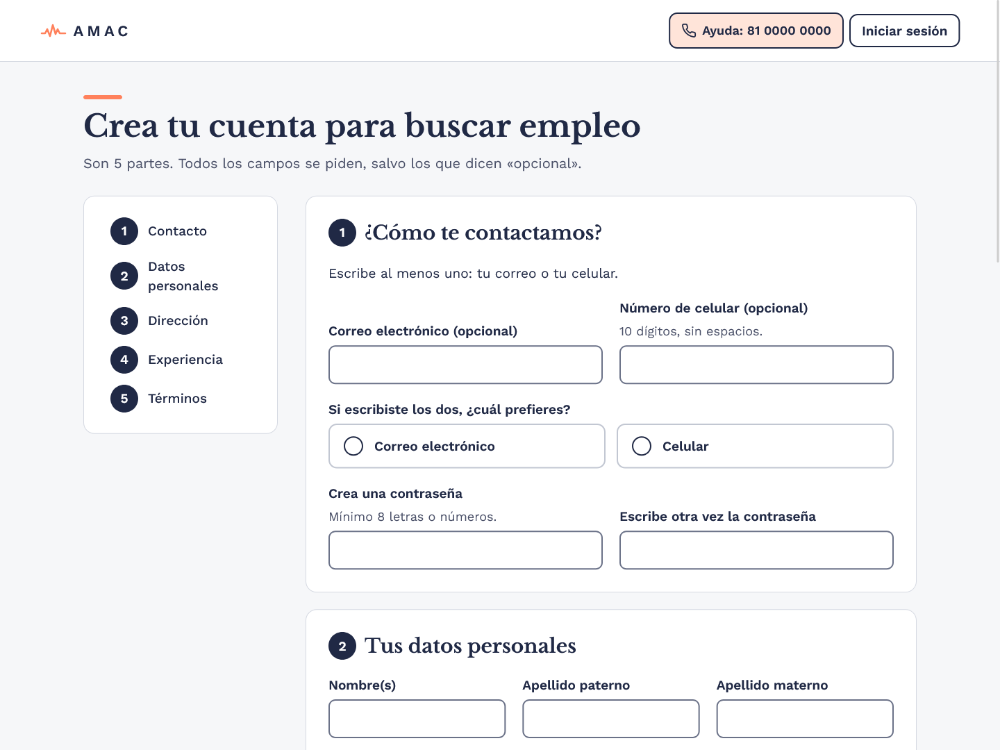
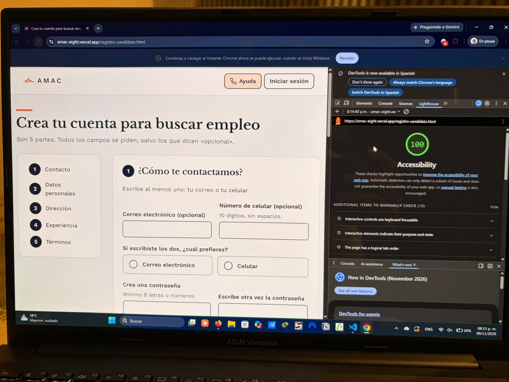

# AMAC: Plataforma de empleo

Entrega 2 del proyecto final de Desarrollo de Aplicaciones Web (OT2026-WEB).

En esta entrega pasamos a código el prototipo que hicimos en Figma para la bolsa de trabajo de AMAC, pensada para personas adultas mayores en Nuevo León. Todo está hecho con HTML y CSS escritos a mano, sin Bootstrap, Tailwind ni plantillas.

**Sitio:** https://amac-web-EQUIPO.vercel.app
**Repositorio:** https://github.com/elihuosuna-a11y/amac-web

## Equipo

| Integrante | Qué hizo |
|---|---|
| Elihu Osuna | Estructura del proyecto, variables de diseño, estilos base y layout (encabezado, menú y pie), listado de vacantes y publicación en Vercel |
| Gustavo Treviño | Componentes reutilizables, detalle de vacante, flujo de postulación y Mis solicitudes |
| Omar Villareal | Inicio de sesión, registro de candidato y de empresa, panel de la empresa, Conoce a AMAC y página 404 |

## Páginas

Las seis que pedía la entrega:

| Página | Pantalla del prototipo | Requerimientos |
|---|---|---|
| `index.html` | Listado de vacantes | RF-001, RF-002, RF-007 |
| `vacante.html` | Detalle de vacante | RF-003, RF-004, RF-051 |
| `login.html` | Inicio de sesión | RF-008 |
| `registro-candidato.html` | Registro de candidato | RF-011, RF-012, RF-013 |
| `mis-solicitudes.html` | Mis solicitudes | RF-005, RF-006 |
| `empresa-vacantes.html` | Panel de vacantes de la empresa | RF-020, RF-021 |

Además agregamos algunas páginas extra:

- `confirmar-postulacion.html` y `postulacion-enviada.html`, para que el flujo de postularse quede completo.
- `registro-empresa.html` (RF-015).
- `conoce-amac.html`, con quiénes somos, contacto, aviso de privacidad y donativos (RF-031 a RF-034).
- `404.html`, que Vercel muestra cuando alguien entra a una dirección que no existe.
- Un modo de alto contraste que se activa solo si la persona lo tiene configurado en su sistema.

Para la demo seguimos este recorrido: listado de vacantes, detalle, Postularme, confirmar, postulación enviada y Mis solicitudes. El panel de la empresa se abre desde el inicio de sesión.

## Cómo está organizado

```
amac-web/
├── css/
│   ├── variables.css
│   ├── base.css
│   ├── layout.css
│   └── componentes.css
├── img/
│   └── iconos/
├── index.html
├── ...demás páginas
└── README.md
```

Separamos el CSS en cuatro archivos:

- **variables.css:** colores, fuentes y espaciados que sacamos de Figma. Si cambiamos un color aquí, cambia en todo el sitio.
- **base.css:** estilos generales de texto, enlaces y el contorno de foco.
- **layout.css:** el encabezado, el menú, el pie de página y cómo se acomoda cada página.
- **componentes.css:** todas las piezas que se repiten.

## Colores

Los copiamos de los estilos del archivo de Figma.

| Variable | Color | Para qué se usa |
|---|---|---|
| `--color-marino` | `#202945` | Texto principal, botones y pie de página |
| `--color-coral` | `#FF815C` | Detalle de los títulos y botón de donativo |
| `--color-texto-secundario` | `#4A5068` | Textos de apoyo |
| `--color-fondo` | `#F6F7F9` | Fondo de las páginas |
| `--color-superficie` | `#FFFFFF` | Tarjetas |
| `--color-superficie-suave` | `#EEF1F6` | Menú activo y etiquetas |
| `--color-superficie-ayuda` | `#FFE4D9` | Botón de ayuda |
| `--color-borde-tarjeta` | `#D5D9E2` | Bordes de tarjetas |
| `--color-borde-campo` | `#6B7288` | Bordes de los campos de formulario |
| `--color-azul-claro` | `#CAE4EF` | Estatus "Enviada" |
| `--color-durazno` | `#FDDAAD` | Estatus "En revisión" y "Pausada" |
| `--color-exito-fondo` | `#D3EBD5` | Estatus "Aceptada" y "Activa" |
| `--color-rechazo-fondo` | `#F6D6D6` | Estatus "Rechazada" |
| `--color-peligro` | `#9B1C1C` | Botones para acciones que no se pueden deshacer |

## Tipografía

Usamos dos fuentes de Google Fonts, las mismas del prototipo:

- **Libre Baskerville** para los títulos.
- **Work Sans** para el texto, los botones y los formularios.

El texto normal mide 19 px y los títulos principales 30 px en celular y 44 px en computadora. Todos los tamaños están en `rem` para que crezcan si la persona agranda la letra en su navegador.

## Componentes que se repiten

Estas son las piezas que identificamos. Cada una tiene su clase en `componentes.css` y la idea es convertirlas en componentes de React en la Entrega 3.

| Clase | Componente en React | Dónde aparece |
|---|---|---|
| `.boton` | `<Boton />` | Todas las páginas (primario, secundario, peligro y deshabilitado) |
| `.boton-ayuda` | `<BotonAyuda />` | Encabezado de todas las páginas (RF-052) |
| `.encabezado` y `.menu` | `<Encabezado />` | Todas las páginas, con versión de candidato, empresa y pública |
| `.pie` | `<PieDePagina />` | Todas las páginas |
| `.titulo-pagina` | `<TituloPagina />` | Título con la línea coral |
| `.tarjeta-vacante` | `<TarjetaVacante />` | Listado de vacantes |
| `.chip` | `<Chip />` | Categoría de la vacante y "También por teléfono" |
| `.estatus` | `<EtiquetaEstatus />` | Mis solicitudes y panel de la empresa |
| `.campo-formulario` | `<CampoFormulario />` | Login y registros |
| `.opcion` y `.casilla` | `<Opcion />` y `<Casilla />` | Opciones de radio y casillas de términos |
| `.habilidad` | `<ChipSeleccionable />` | Habilidades en el registro |
| `.zona-archivo` | `<SubirArchivo />` | Subir CV, logo y banner |
| `.paso` | `<NumeroPaso />` | Partes del registro y proceso de selección |
| `.aviso` | `<Aviso />` | Mensajes informativos |
| `.tabla` | `<TablaResponsiva />` | Mis solicitudes y panel de la empresa |
| `.pastilla` | `<FiltroEstado />` | Filtro por estado en el panel de la empresa |

## Accesibilidad

Como el sitio es para personas adultas mayores, cuidamos sobre todo esto:

- La letra nunca es menor a 18 px y crece con el zoom del navegador.
- Todos los textos tienen buen contraste (mínimo 4.5:1).
- Los botones y enlaces miden al menos 44 px de alto, la mayoría 56 px, para que sean fáciles de tocar.
- Cada campo tiene su etiqueta visible arriba; no dependemos del texto de ejemplo dentro del campo.
- Al navegar con la tecla Tab siempre se ve dónde está el foco.
- Hay un enlace de "Saltar al contenido" al inicio de cada página.
- Cada estatus lleva ícono y palabra, no solo color.
- Cada página tiene un solo título principal y los demás títulos van en orden.
- El sitio se puede usar con zoom al 200 % sin que se corte nada.

## Diseño responsivo

Empezamos diseñando para celular y después agregamos cambios para tablet (768 px) y computadora (1024 px).

- En celular el menú está abajo, con ícono y texto, igual que en el prototipo. En computadora pasa al encabezado.
- Las tablas se convierten en tarjetas en pantallas chicas para que no haya que deslizar hacia los lados.
- Lo probamos en 320, 768, 1024 y 1440 px.

## Cambios respecto a Figma

Hay algunas cosas que cambiamos del prototipo:

- **Login y registro con encabezado y pie:** la entrega pide que estén en todas las páginas, así que usamos la versión pública del encabezado que ya teníamos en Figma.
- **Filtro de horario en celular:** en el prototipo era una lista desplegable; lo dejamos como opciones visibles para que no haya que abrir nada. Agregamos el botón "Aplicar filtros" porque sin JavaScript se necesita para mandar el filtro.
- **Confirmar postulación como página:** en Figma era una ventana emergente, pero sin JavaScript no se puede hacer.
- **Botón de Postularme en celular:** en el prototipo iba fijo abajo; lo pusimos debajo del título para que no se encime con el menú.
- **Menú de la empresa:** "Solicitudes" y "Perfil" no los incluimos porque esas pantallas eran opcionales; quedan para la Entrega 3.

Algunos botones, como "Guardar vacante", "Cancelar solicitud" o "Pausar", por ahora solo son visuales; van a funcionar cuando pasemos a React. Los teléfonos que aparecen son de ejemplo.

## Capturas

**Página principal en celular y en computadora**

| Celular | Computadora |
|---|---|
|  |  |

**Lighthouse (Accesibilidad)**

